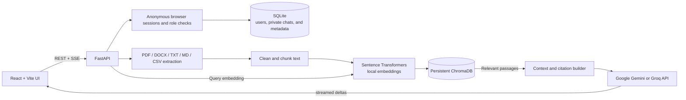
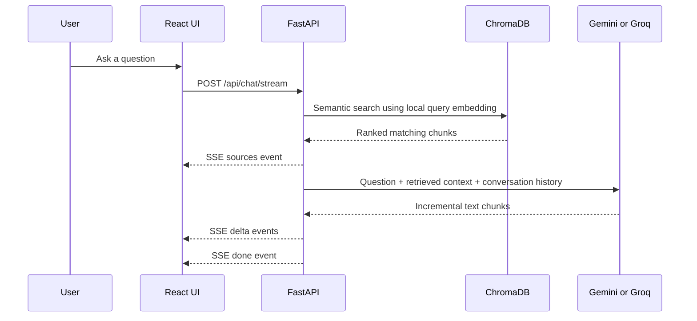

# Inkwell — production RAG + agent

> **v2:** hybrid search, a tool-calling agent, follow-up understanding, multi-tenant namespaces and a service API so other apps (MarketBid, DistributionOS) can use it as their AI backend. See [INTEGRATION.md](INTEGRATION.md) and [CHANGELOG.md](CHANGELOG.md).

Inkwell is a single-company document Q&A workspace. Anyone who reaches the chat is automatically given an employee session for that browser; conversation histories stay private to that session. An administrator manages the shared document library and workspace settings. It extracts text from PDF, DOCX, TXT, Markdown, and CSV files, embeds overlapping text chunks locally, stores them in persistent ChromaDB, and retrieves relevant passages before asking Google Gemini or Groq to answer. Responses stream over Server-Sent Events and include source citations.

The app uses per-browser HTTP-only session cookies and backend role checks. A strong administrator bootstrap key is generated locally and can be claimed once in the collapsed **Administrator access** section of Settings; it is never built into the source. It is an internal deployment starting point—not a hardened public SaaS. Anyone who can reach the app can use it as an employee, so restrict network access and put it behind HTTPS before using company data; the development server and default cookie configuration use plain HTTP.

> **Model note:** The default provider is Groq (`LLM_PROVIDER=groq`) with `openai/gpt-oss-120b`. Groq retired `llama-3.3-70b-versatile` for free and developer accounts on August 16, 2026. Available models and account rate limits can change, so check the [model catalog](https://console.groq.com/docs/models) and [rate limits](https://console.groq.com/docs/rate-limits). Gemini is also supported. Free-tier eligibility and quotas depend on each provider's current terms and your account.

## Architecture



### Request flow



## Technology

- **Frontend:** React, Vite, TypeScript, Tailwind CSS, Lucide React, React Markdown, remark-gfm
- **API:** Python 3.14, FastAPI, Pydantic Settings, Uvicorn
- **LLM:** official `openai` Python SDK against each provider's OpenAI-compatible endpoint (Groq, Gemini, OpenAI, or any compatible server), streaming responses and tool calling
- **Embeddings:** Sentence Transformers, default `sentence-transformers/all-MiniLM-L6-v2` (384-dimensional vectors)
- **Vector store:** persistent local ChromaDB using cosine distance
- **Conversation storage:** SQLite
- **Account security:** PBKDF2 password hashes, HTTP-only sessions, administrator/employee roles
- **Document extraction:** pypdf, python-docx, Python CSV/text handling
- **Tests:** pytest, FastAPI TestClient/httpx, frontend TypeScript/Vite production build

## Folder structure

```text
backend/
  app/
    api/routes/       Authentication, users, documents, chat, conversations, settings APIs
    core/             Environment configuration and logging
    schemas/          Pydantic request/response models
    services/         Authentication, extraction, cleaning, chunking, embeddings, Chroma,
                      SQLite, retrieval, Gemini, answer cache, and ingestion services
    cli.py            Local administrator-key generation command
    main.py           FastAPI application and authentication wiring
  data/               Persistent local uploads and ChromaDB data
  tests/              Unit and API tests
  .env.example
  requirements.txt
frontend/
  src/
    components/       Chat, documents, and settings UI
    services/         HTTP and SSE client
    types/
    App.tsx
    index.css
  package.json
  vite.config.ts
README.md
start.bat
```

## Requirements

- Windows 10/11
- Python 3.14 (the project does not silently select an older Python)
- Node.js 20+ and npm
- A Google Gemini or Groq API key for generated answers

Sentence Transformers downloads the configured embedding model the first time a document is embedded. The download and inference happen on the backend machine; no paid embedding service is used. ChromaDB, SQLite, and uploaded files remain local.

## Setup

Open PowerShell in this project folder.

### 1. Create a Python 3.14 environment

```powershell
py -3.14 -m venv backend\.venv
backend\.venv\Scripts\python.exe -m pip install --upgrade pip
backend\.venv\Scripts\python.exe -m pip install -r backend\requirements.txt
```

Python 3.14 compatibility is declared by Sentence Transformers. If a binary dependency (commonly PyTorch or ChromaDB's native dependencies) does not provide a compatible wheel for your machine, pip will report that explicitly; do not silently switch to another Python version.

### 2. Configure a language model provider

Copy the example file and edit it:

```powershell
if (-not (Test-Path backend\.env)) { Copy-Item backend\.env.example backend\.env }
notepad backend\.env
```

The server's `.env` is excluded from Git. API keys are written to this file and are never returned by the API. The administrator-key setup command creates the `SETTINGS_PASSWORD_HASH` if it is not already configured; this is a separate password that protects provider-key changes. Its unlock token is held in browser memory and expires after 15 minutes.

**Groq (default):** create your own API key at [Groq Console API keys](https://console.groq.com/keys). In `backend/.env`, set:

```dotenv
LLM_PROVIDER=groq
GROQ_API_KEY=paste-your-own-key-here
GROQ_MODEL=openai/gpt-oss-120b
```

Groq's account limits and model availability vary; check its current [models](https://console.groq.com/docs/models) and [rate-limit documentation](https://console.groq.com/docs/rate-limits).

**Gemini alternative:** create a key at [Google AI Studio API keys](https://aistudio.google.com/apikey), then set:

```dotenv
LLM_PROVIDER=gemini
GEMINI_API_KEY=paste-your-own-key-here
GEMINI_MODEL=gemini-3.8-flash
```

Check Google's current [models](https://ai.google.dev/gemini-api/docs/models) and [pricing/free-tier table](https://ai.google.dev/gemini-api/docs/pricing) for your account and region.

After submission, the API never returns the key to the browser; the backend uses it only to authenticate requests to the selected provider. The key is stored as plain text in the server's Git-ignored `backend/.env`, so protect the server and do not commit or share that file. The development connection uses unencrypted HTTP; never enter a real provider key over the development server from another device.

On the **Settings** page, enter the settings password, unlock provider settings, choose Groq or Gemini, paste your own provider key and model, then select **Save provider**. The update takes effect immediately and is persisted in `backend/.env`; the API only reports whether a key exists, never the key itself. Select **Lock** when finished.

To change the settings password later, generate a fresh salted hash from the backend folder:

```powershell
Set-Location backend
.\.venv\Scripts\python.exe -c "from getpass import getpass; from app.services.settings_security import hash_settings_password; print(hash_settings_password(getpass('New settings password: ')))"
```

Replace `SETTINGS_PASSWORD_HASH` in `backend/.env` with the printed value and restart the backend. Do not put the raw password in source code or commit the `.env` file.

### 3. Generate the one-time administrator key

From the backend folder, generate a random bootstrap key on the server:

```powershell
Set-Location backend
.\.venv\Scripts\python.exe -m app.cli generate-admin-key
Set-Location ..
```

Copy the key from the command output; it is not saved in plaintext. If `SETTINGS_PASSWORD_HASH` is not set yet, the command also asks you to choose a separate provider-settings password. Start or restart the backend after generating the key. In the browser, open **Settings → Administrator access**, paste the key, and select **Claim admin**. The first successful claim consumes the key and turns that browser's employee session into the administrator session.

Every other browser remains an employee and can use the shared library without signing in. The administrator controls document uploads and workspace configuration. Use this only on a trusted network: reaching the app grants employee access, and development HTTP is not suitable for real company data.

### 4. Install and start the frontend

```powershell
Set-Location frontend
npm install
npm run dev
```

### 5. Start the backend

In a second PowerShell window at the project root:

```powershell
backend\.venv\Scripts\python.exe -m uvicorn app.main:app --app-dir backend --reload --host 127.0.0.1 --port 8001
```

Open [http://localhost:5173](http://localhost:5173). The browser automatically opens a private employee session. The Vite development server proxies `/api` requests to the backend on port 8001.

For local development only, another device on the same Wi-Fi can use the PC's Wi-Fi IPv4 address and port 5173. This development connection is plain HTTP and is not suitable for real company credentials or sensitive documents. Do not use the Vite development server as a company deployment.

The backend health endpoint is [http://localhost:8001/api/health](http://localhost:8001/api/health), with interactive API docs at [http://localhost:8001/docs](http://localhost:8001/docs).

Alternatively, double-click `start.bat` from the project root. It creates the Python environment if missing, installs dependencies, creates `.env` from the example only when needed, starts both development servers in separate windows, and opens the frontend. Generate the administrator key with the command above before attempting the first admin claim.

## How ingestion, embeddings, and retrieval work

1. The upload endpoint checks supported extensions, MIME type, and the configured maximum file size (20 MB by default); it sanitizes the display name and rejects duplicate file contents using SHA-256.
2. The loader extracts text and PDF page numbers. Text is Unicode-normalized and whitespace-cleaned. CSV rows are represented as readable, pipe-separated text.
3. Chunking defaults to 800 characters with 150 characters of overlap. Chunks end on paragraph, line or sentence boundaries where possible (never mid-word), and overlaps start on a word. Both values can be changed in Settings. New uploads use current values; call `POST /api/documents/reindex` to rebuild every existing document after changing them.
4. Sentence Transformers loads once per backend process. It produces normalized 384-dimensional vectors in batches, separately from ChromaDB storage.
5. ChromaDB stores chunk text, vectors, and document/page/chunk/namespace metadata under `backend/data/chroma_db`, and survives restarts. Writes are batched, so large documents index reliably. Deleting a document also deletes its vectors and uploaded file, including when it is deleted mid-ingestion. Documents left in `processing` by a restart are resumed automatically.
6. **Hybrid retrieval.** Each search runs vector similarity *and* BM25 keyword search, then merges both rankings with reciprocal rank fusion. Keyword search catches exact tokens that embeddings miss: order numbers, SKUs, phone models, names. A chunk is kept if it passes the similarity threshold or is a strong keyword hit.
7. **Agent mode (default).** The model decides what to do: search the knowledge base (rewriting follow-ups like "what about its price?" into standalone queries), list or read whole documents for summaries, or call your app's live tools. Answers cite numbered sources like `[1]`, and only the cited sources are shown. Set `AGENT_ENABLED=false` for classic single-search RAG (one LLM call; follow-ups are rewritten with a small extra call when `QUERY_REWRITE=true`). If a model rejects tool calling, the backend falls back to classic RAG automatically.
8. Standalone greetings receive a friendly reply without a model call. If no document has finished indexing (and the namespace has no app tools), the assistant asks the user to upload one. A question and its answer are saved together only when the answer finishes, so failures never leave half-saved conversations; if the browser disconnects mid-answer, the partial answer is saved and marked as interrupted.
9. SQLite persists conversations, message history, document metadata, and UI-adjustable retrieval/chunking settings across restarts. Chat history is contextual only; document retrieval remains the factual source.

Uploaded file instructions are treated as untrusted reference content. Prompt injection protections are applied, but no prompt-based control can guarantee that a generative model will never make an unsupported statement; verify citations for consequential decisions.

## Configuration

`backend/.env.example` contains all supported variables:

| Variable | Default | Description |
|---|---|---|
| `LLM_PROVIDER` | `groq` | Active provider: `groq`, `gemini` or `openai` (all via the OpenAI-compatible API) |
| `OPENAI_API_KEY` / `OPENAI_MODEL` | empty / `gpt-5-mini` | OpenAI credentials and model |
| `LLM_BASE_URL` | empty | Override endpoint for any OpenAI-compatible server (OpenRouter, Ollama, vLLM) |
| `LLM_TIMEOUT_SECONDS` / `LLM_MAX_RETRIES` | `60` / `2` | Per-request timeout and automatic retries on 429/5xx |
| `AGENT_ENABLED` | `true` | Tool-calling agent; `false` = classic single-search RAG |
| `AGENT_MAX_STEPS` | `4` | Maximum model rounds (tool calls) per answer |
| `AGENT_CONFIG_PATH` | `agent_config.json` | Per-namespace assistant name, instructions and app tools |
| `QUERY_REWRITE` | `true` | Classic mode: rewrite follow-up questions before searching |
| `HISTORY_MESSAGES` | `12` | Recent messages sent to the model |
| `SERVICE_API_KEYS` | empty | Server-to-server keys: `name:sha256:namespace_glob`, comma-separated |
| `CHAT_RATE_LIMIT_PER_MINUTE` | `30` | Messages per minute per user (or per service key + `user_ref`) |
| `HYBRID_SEARCH` | `true` | Combine BM25 keyword search with vector search |
| `EMBEDDING_QUERY_PREFIX` / `EMBEDDING_PASSAGE_PREFIX` | empty | Prefixes for models such as e5 (`query: ` / `passage: `) |
| `GROQ_API_KEY` | empty | Backend-only Groq API key |
| `GROQ_MODEL` | `openai/gpt-oss-120b` | Groq model identifier |
| `GEMINI_API_KEY` | empty | Backend-only Google AI Studio API key |
| `GEMINI_MODEL` | `gemini-3.8-flash` | Gemini model identifier |
| `SETTINGS_PASSWORD_HASH` | configured in local `.env` | Salted PBKDF2 hash guarding provider key changes |
| `ADMIN_BOOTSTRAP_KEY_HASH` | generated by `app.cli generate-admin-key` | Salted PBKDF2 hash for the one-time admin claim; never paste a raw key here |
| `AUTH_COOKIE_SECURE` | `false` for local development | Set to `true` when the company app is served over HTTPS |
| `EMBEDDING_MODEL` | `sentence-transformers/all-MiniLM-L6-v2` | Local sentence embedding model |
| `CHUNK_SIZE` / `CHUNK_OVERLAP` | `800` / `150` | Default character chunking configuration |
| `TOP_K` | `5` | Default maximum retrieved chunks |
| `SIMILARITY_THRESHOLD` | `0.25` | Minimum cosine similarity |
| `MAX_CONTEXT_CHARS` | `12000` | Maximum retrieved context per answer (agent: half of this per tool call) |
| `MAX_FILE_SIZE_MB` | `20` | Per-file upload limit |
| `CORS_ORIGINS` | `http://localhost:5173` | Comma-separated allowed browser origins for direct API access |
| `DATABASE_PATH` | `data/rag_chatbot.sqlite3` | SQLite storage path, relative to `backend` |
| `CHROMA_PATH` | `data/chroma_db` | Chroma persistent directory |
| `UPLOAD_PATH` | `data/uploads` | Uploaded source files directory |

Settings changed through the UI are stored in SQLite and take precedence over matching defaults. API secrets are not stored in SQLite or returned from settings endpoints.

## API endpoints

| Method | Path | Purpose |
|---|---|---|
| GET | `/api/health` | Backend/model configuration health |
| GET | `/api/auth/status` | Check whether the browser has a valid sign-in session |
| POST | `/api/auth/login` | Sign in and set an HTTP-only session cookie |
| POST | `/api/auth/logout` | Revoke the current session |
| POST | `/api/auth/change-password` | Replace a temporary employee password |
| POST | `/api/auth/claim-admin` | Claim admin role with the one-time generated key |
| POST | `/api/documents/upload` | Upload one or more files |
| GET | `/api/documents` | List indexed and failed documents |
| GET | `/api/documents/{document_id}` | Get document processing status |
| DELETE | `/api/documents/{document_id}` | Remove file and all its vectors |
| POST | `/api/documents/{document_id}/reprocess` | Rebuild chunks and vectors (runs in the background) |
| POST | `/api/documents/reindex` | Rebuild every document, e.g. after changing chunk size or embedding model |
| POST | `/api/chat` | Non-streaming chat response |
| POST | `/api/chat/stream` | SSE stream: `meta`, `status` (agent steps), `sources`, `delta`, `done`, or `error` |
| * | `/api/v1/namespaces/{namespace}/...` | Service API for other apps; see [INTEGRATION.md](INTEGRATION.md) |
| GET / POST | `/api/conversations` | List or create conversations |
| GET / PATCH / DELETE | `/api/conversations/{conversation_id}` | Read, rename, or delete a conversation |
| GET / PATCH | `/api/settings` | Read or update chunking and retrieval settings |
| POST | `/api/settings/unlock` | Verify settings password; returns a 15-minute in-memory token |
| POST | `/api/settings/provider` | Set provider/model/key (requires `Authorization: Bearer <token>`) |
| POST | `/api/settings/lock` | Revoke an unlock token |

Browser state-changing API calls include an `X-Inkwell-Request` header to prevent cross-site form requests. The browser app adds it automatically; direct API clients must send `X-Inkwell-Request: 1`.

## Answer cache

First-turn answers (no conversation history) are cached in backend memory for up to 10 minutes, with a 512-entry limit, and shared by everyone in the same namespace, since everyone reads the same documents. A repeated FAQ such as "how do I place a bid?" is answered instantly and without spending provider quota. The key includes the namespace, the normalized question, every document's version, and the model and retrieval settings, so any upload, deletion or setting change invalidates it. Follow-ups, regenerations, requests with user context, and namespaces with live app tools are never cached.

## Docker deployment

```bash
cp backend/.env.example backend/.env   # add your provider key, set AUTH_COOKIE_SECURE=true behind HTTPS
docker compose up -d --build           # UI + API on http://localhost:8080
```

nginx serves the built UI and proxies `/api` to the backend with buffering off, so streaming works. Data (SQLite, Chroma, uploads, the embedding-model cache) lives in the `rag-data` volume. Generate the admin key inside the container with `docker compose exec backend python -m app.cli generate-admin-key`. Put the stack behind HTTPS (Caddy, Cloudflare Tunnel, or your host's proxy) before using company data.

## Tests and build

From the project root:

```powershell
backend\.venv\Scripts\python.exe -m pytest backend\tests -q
Set-Location frontend
npm run build
```

Install test tools with `pip install -r backend/requirements-dev.txt`. Tests script the LLM (including tool calls) and use a tiny fake embedding model, so they need no API key or model download. They exercise real Chroma storage, hybrid search, the agent loop, the service API and namespace isolation against temporary directories.

## Troubleshooting

- **Provider API key missing:** set the matching `GROQ_API_KEY`, `GEMINI_API_KEY` or `OPENAI_API_KEY` in `backend/.env`, set `LLM_PROVIDER` accordingly, and restart Uvicorn. Document upload and retrieval work without a provider key, but generated answers need one.
- **Model unavailable / quota exceeded:** check the selected provider's current model and rate-limit pages, then update the model on the Settings page. The former default `llama-3.3-70b-versatile` was retired for free and developer Groq accounts on August 16, 2026.
- **First upload is slow:** the embedding model is downloaded and initialized on first use; subsequent operations reuse it.
- **Python dependency wheel unavailable:** check the exact pip error and compatible package releases for Python 3.14 and your architecture. Do not silently downgrade Python.
- **Frontend cannot connect:** confirm Uvicorn is listening on `127.0.0.1:8001`, then restart the Vite server so its `/api` proxy is active.
- **Document status is failed:** inspect its error on the Documents page; scanned/image-only PDFs need OCR, which is not included in this implementation.
- **No relevant sources:** lower the similarity threshold, increase top-K, reprocess after adjusting chunk settings, or ask a question phrased closer to the document.

## Limitations

- Scanned PDFs and images are not OCR-processed.
- Files are stored unencrypted on local disk; protect the machine and backups accordingly.
- Provider free-tier limits, model access, and retention policies are set by each provider and can change. Agent mode uses 2–3 model calls per answer; on tight free tiers set `AGENT_ENABLED=false`.
- Run the backend as a single worker process: the ingestion queue, rate limiter and answer cache live in memory. Scale up by moving them to Redis and Chroma to its server mode.
- The keyword index is rebuilt in memory per namespace; it is fine for tens of thousands of chunks. For millions, move to a search engine with native hybrid search.
- Chat titles are generated from the first user question; rename them from the conversation list.
